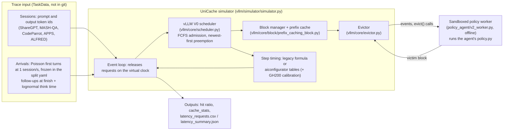
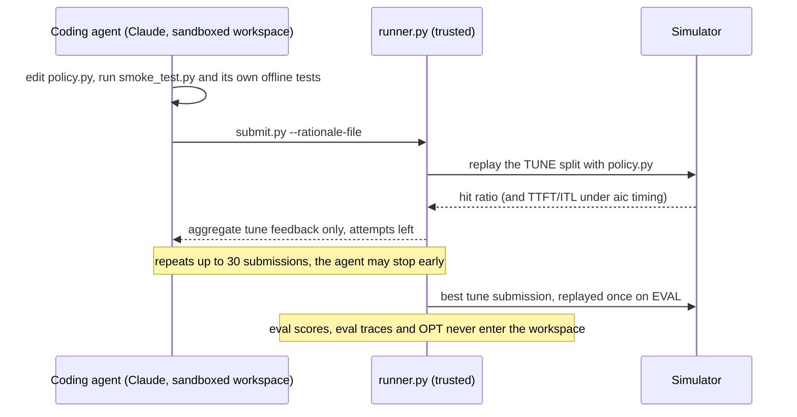
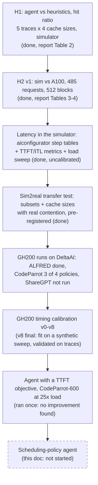
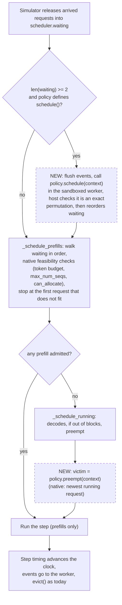

# Handoff: letting the agent modify the scheduling policy

Status, 2026-11-26: **design only; nothing is implemented.** Today the agent
edits only the prefix-cache eviction policy. This doc explains how to let it
also edit *request scheduling*: which waiting request is admitted next, and
which running request is preempted. It covers where those decisions happen in
the code, what must hold before results mean anything, a proposed interface,
and an implementation order with checks.

Read first: `AGENTS.md` (project context and rules), `policy_agent/v2_api.md`
(the current policy contract) and `docs/aic-timing.md` (latency mode). The
report's next steps list "let the agent edit the wider serving system (routing,
admission, batching, offload, prefetch)". This is the first slice of that.

Work on branch `experiment/scheduling-policy`. It is `experiment/aic-timing`
(with `engine_time()`, `cache_stats.py`, the Linux policy sandbox and the
sim2real scripts) plus `AGENTS.md` and this doc. This work changes
`vllm/core/scheduler.py`, which `AGENTS.md` says needs coordination with
the simulator-core work.

**Not on this branch yet** (the in-progress calibration work,
uncommitted on 2026-11-26): the runner's `--objective ttft` and `--timing aic`
flags, latency fields in the runner's score, and charging policy-worker CPU
time to the virtual clock (`COUNTERS` in `bridge.py`, `policy_charge` in
`step_timing.py`). Sections below that mention these are marked
**[pending]**. Until they land, run the simulator directly with
`--simulator-timing aic` and read `latency_summary.json`.

## 0. Getting started

**Setup** (macOS or Linux, Python 3.12, no GPU needed):

```bash
git clone -b experiment/scheduling-policy https://github.com/miguelaenlle/UniCache
cd UniCache
bash setup-simulator312.sh                         # creates .venv-sim312 (editable install)
uv pip install --python .venv-sim312/bin/python -r requirements/simulator-aic.txt   # aiconfigurator timing
./sim                                              # 20-session ShareGPT smoke run
```

`LOCAL_SETUP.md` covers model metadata
(`scripts/local_sim.py download --model models/Llama-3.2-1B-Instruct`; config
and tokenizer only, no weights) and the `doctor` check.

**Trace data** is not in git (`TaskData/**/*.jsonl` is ignored). For this work
you need CodeParrot (single-turn, about 140 MB) and AgentBank ALFRED
(multi-turn, about 615 MB). Either get the prepared files from the team, or
regenerate them by following `TaskData/Codeparrot/readme.md` and
`TaskData/AgentBankData/readme.md`. They go to the `data_path` in
`TaskData/Codeparrot/tasks_config.yaml` and
`TaskData/AgentBankData/tasks_config_alfred.yaml`. The tune/eval splits under
`TaskData/*/agent-splits/` are built from them on the first
`./policy-agent run` (`--prepare-only` builds them without running anything).

**Latency runs.** `policy_agent/runner.py` writes a `command.json` for every
replay it runs. `scripts/aic_timing/rerun_with_latency.py` re-runs any such
command with aiconfigurator timing and a compressed arrival rate:

```bash
.venv-sim312/bin/python scripts/aic_timing/rerun_with_latency.py \
  --commands <run>/command.json --out result/sched/<name> \
  --timing aic --system h100_sxm --arrival-scale 0.1     # 10x the recorded load
```

Each run writes `latency_requests.csv`, `latency_summary.json` and the hit
ratio summary.

**Docs on this branch, in reading order:**

| Doc | Why |
|---|---|
| `AGENTS.md` | Project context, setup table, rules (reward-hacking guards, how to report) |
| `POLICY_AGENT.md` | The agent loop: CLI, sandbox, submissions, tune/eval scoring |
| `policy_agent/v2_api.md` | The v2 policy contract this design extends (events, `evict`) |
| `POLICY_INTERFACE_V2_PLAN.md` | Why v2 looks the way it does (no fallback, event stream) |
| `docs/aic-timing.md` | Latency mode, `--arrival-scale`, the load sweep, why legacy timing hides latency effects |
| `EXPERIMENTS.md`, `LOCAL_SETUP.md` | Running baselines and the hit-ratio matrix |
| this doc | The scheduling design and build order |

The mid-semester report (the project's full writeup) is not in the repo. Ask
the team for the PDF.

## 0.5 Where the project stands: what we have and what has run

### What we have

The system is a simulator of one vLLM serving instance, plus a coding agent
that rewrites one component of it, the eviction policy:



* **Model and outputs.** No weights are used. Llama-3.2-1B-Instruct sets the
  shapes, and each request's output is forced to the trace's recorded tokens.
  Hit ratios therefore depend only on scheduling and eviction.
* **Same code on a GPU.** `--disable-simulation --device cuda` runs real
  forward passes (dummy weights) on wall-clock time through the same
  scheduler, block manager and evictor. That is how sim2real works.

The agent loop, `./policy-agent run` (`policy_agent/runner.py`):



### What has been run



**H1: agents vs heuristics (simulator, hit ratio).** Claude Opus, 30
submissions, starting from LRU, 8-token blocks. On the 9 configurations with
more than 5 pp of tune headroom (eval, pp):

| Trace | Cache (GiB) | Best heuristic | OPT − LRU | Agent − LRU | Agent − best |
|---|---:|---|---:|---:|---:|
| ShareGPT | 4 | UniCache | 19.95 | +0.04 | +0.04 |
| MASH-QA | 4 | LeCaR | 25.05 | −0.12 | −0.07 |
| CodeParrot | 4 | UniCache | 33.64 | +4.88 | −3.59 |
| MASH-QA | 8 | UniCache | 26.55 | +0.09 | −0.22 |
| ALFRED | 8 | LeCaR | 29.10 | +10.08 | −0.71 |
| CodeParrot | 8 | UniCache | 26.62 | +11.40 | −2.46 |
| MASH-QA | 12.207 | UniCache | 24.83 | −0.16 | −2.22 |
| CodeParrot | 12.207 | UniCache | 13.65 | +10.84 | −2.63 |
| MASH-QA | 24 | UniCache | 8.81 | +1.22 | −1.23 |
| **Average** | | | 23.13 | **+4.25** | **−1.46** |

So agents beat LRU but not yet the best existing heuristic.

**H2 v1: simulator vs A100 (hit ratio).** 485 requests from the five traces,
512 blocks. Mean absolute sim-vs-GPU error was 0.05–1.45 pp on four traces.
UniCache's gain over LRU agreed within 0.3–0.7 pp. ShareGPT was off by about
51 pp: its follow-up turns arrive after the previous turn finishes, so its
reuse depends on decode timing, and legacy timing charges 10 ms per decode
step, where the GPU takes 2–4 ms.

**Latency in the simulator.** `--simulator-timing aic` charges each engine
step from aiconfigurator's measured kernel tables, so cache hits shorten
prefill. Every run writes TTFT/ITL/E2E (`docs/aic-timing.md`). Under legacy
timing all eviction policies have identical TTFT.

**Sim2real transfer test on one GH200** (16-token blocks, simulator numbers
pre-registered before any GPU run, `docs/sim2real-results.md`). Hit ratio, %:

| Trace (cache) | Policy | Simulator (legacy) | GH200 |
|---|---|---:|---:|
| ALFRED, 60 sessions (512 blocks) | LRU | 33.45 | 34.91 / 34.95 (2 runs) |
| | UniCache | 33.45 | 34.73 |
| | LeCaR | 35.34 | 37.47 |
| | Agent (H1) | 35.25 | 37.58 |
| CodeParrot, 600 sessions (4,096 blocks) | LRU | 16.05 | 15.88 |
| | UniCache | 18.89 | 18.93 |
| | LeCaR | 18.19 | 17.89 |
| | Agent (H1) | 18.54 | pending |

On ALFRED, every gap to LRU has the same sign on both sides. UniCache's gap
transfers. LeCaR's (sim +1.89, GPU +2.56) and the agent's (sim +1.80, GPU +2.66)
are 0.7–0.9 pp off, beyond the 0.5 pp tolerance. ShareGPT has not been run.

**GH200 timing calibration.** Calibrations v0–v8 fitted the simulator's step
times to GH200 measurements. **v8 is final.** It is fit on a synthetic sweep
only, with a direct prefill/decode step model, a cost per evicted block, a
cost per request arrival (tokenization) and a cost per policy-worker call. It
was validated on 9 held-out trace conditions:

| Metric vs GH200 | Untuned (legacy) | v8 |
|---|---:|---:|
| Hit ratio, mean abs diff | 0.65 pp | 0.12 pp |
| ITL, median abs error | 348 % | 3 % |
| TTFT, median abs error | 137 % | 13 % |
| TTFT at 33× load (queueing) | +620 % | −13 to −19 % |

**Measured on the GH200 (CodeParrot-600, 4,096 blocks)**, the facts that
matter most for scheduling:
* **Saturation is between 20× and 33× the recorded arrival rate.** TTFT for
  LRU: 22.5 ms at 20× (no queue), 1,815 ms at 33× (queueing).
* **A cache hit saves little on a 1B model.** A prefill step is about 10.8 ms
  plus 0.6 ms per 1,000 new tokens. UniCache's +2.8 pp hit ratio bought no TTFT
  (26.5 ms vs 22.5 ms at 20×; that GPU gap is unexplained).
* **Decode steps grow with batch:** 2.3 ms at 1–4 sequences, 3.9 ms at 25–32.

**Agent with a TTFT objective** (CodeParrot-600, 25× load, tune/eval slices
of 600 sessions, ran once). The agent stopped after 5 submissions and kept
the unchanged LRU. Three causes:
1. The objective was noisy (±10–40 %). That calibration (v4) charged measured
   laptop CPU time, which v8 replaced with deterministic per-call charges.
2. +1–4 pp of hit ratio is worth about 5 % of TTFT here.
3. Running the policy in a sandboxed process costs about 30 ms (+45 %) of TTFT
   per run, versus built-in policies, so agent policies start behind.

**Where these files are.** H1 is on `experiment/agent-budget-v1` (results in
`result/agent-cache-budget-study/`). H2 v1 is on `experiment/sim2real-subset`.
The sim2real pre-registration and scripts are on this branch. The GH200 run
log, calibrations v0–v8 and the TTFT-objective runner are in the calibration
work, which is not on this branch yet (see above).

## 1. Question

If a coding agent can change the request scheduler, alone or together with
eviction, does it reduce TTFT compared with FCFS and with the best simple
scheduling heuristic, under the same submission budget?

Scope for the first version:
* **In:** the order in which waiting requests are admitted; which running
  request is preempted when the cache is full.
* **Out, for now:** routing (we simulate one instance), batching knobs
  (`max_num_seqs`, token budget, chunked prefill), offload and prefetch.
  Section 7 has notes on these.

## 2. Where scheduling happens today

Everything is in the vLLM V0 scheduler, `vllm/core/scheduler.py`. The
simulator and the GPU replay both run this code, so a change here applies to
both.

| What | Where | Today's behavior |
|---|---|---|
| Queues | `Scheduler.__init__`, around line 499 | Three deques: `waiting`, `running`, `swapped` |
| Arrival | `add_seq_group` (line 581) | Appends to `waiting`; emits a `request_state` event |
| One engine step | `_schedule` (line 1493) → `_schedule_default` (line 1257) | Chunked prefill is hard-coded off (`run_simulation.py:219`), so it is always `_schedule_default` |
| Step structure | `_schedule_default` | With nothing swapped, admit prefills first. Decodes run only in a step with no new prefills. |
| Admission | `_schedule_prefills` (line 1066) | **FCFS.** Walks `waiting` from the head. Stops at the first request that does not fit the token budget, `max_num_seqs` or free blocks (`can_allocate == LATER`): head-of-line blocking. |
| Preemption victim | `_schedule_running`, line 787 | `running_queue.pop()`: the most recently admitted running request |
| Priority mode | `_get_priority` (line 990), `_schedule_priority_preemption` (line 1001) | Unreachable from the simulator: `run_simulation.py` builds `LLM(...)` without a scheduling policy, so it is always `fcfs`. If enabled, it sorts by `(seq_group.priority, arrival_time)`, and the simulator never sets `priority`. |
| Cached prefix of a request | `_get_num_new_uncached_and_cached_tokens` (line 1967) → `get_num_cached_tokens` (`prefix_caching_block.py:1930`) | Prefill accounting uses this. **See pitfall P1:** the value is memoized per waiting sequence. |

Settings in every H1 and sim2real run: `max_num_seqs=32`, block size 8 (16 on
GH200), 0 CPU swap blocks (so preemption is always recompute), chunked prefill
off.

## 3. How eviction policies plug in (the pattern to copy)

1. `run_simulation.py --eviction-policy LRU` with the env var
   `UNICACHE_POLICY_CANDIDATE=policy.py` and `UNICACHE_POLICY_INTERFACE=v2`.
2. `make_evictor` (`vllm/core/evictor.py:1890`) builds an
   `IndependentEvictor` (`policy_agent/v2_bridge.py:82`).
3. That object starts **one sandboxed worker process** (`V2Remote` →
   `policy_agent/v2_worker.py`), offline (Seatbelt on macOS; `unshare`, `bwrap`
   or `outer-offline` on Linux, with no unsandboxed fallback), with 30 s per
   callback and 600 CPU-s per worker.
4. The engine streams events to it (`policy_agent/events.py`; the kinds are
   listed in `v2_api.md`). When it needs a victim, it flushes pending events and
   calls `evict(context)`. The worker checks that `through_event_id` matches
   (no decision on stale state), and the host rejects any invalid victim. There
   is **no fallback**: a bad answer fails the submission.
5. `policy_agent/runner.py` runs the agent loop: workspace, submissions,
   scoring on tune, selection by tune score. **[pending]** A TTFT objective
   (`--objective ttft`, which requires `--timing aic`) is in the in-progress
   calibration work.

A scheduling policy should use the same worker, events, sandbox and
no-fallback rule.

## 4. Prerequisites: what makes scheduling measurable

Get these right first. Without them every scheduling result is noise or an
artifact.

**4.1 Timing must respond to the schedule.** The default `legacy` timing
charges prefill by the full prompt length, ignoring cached tokens, and charges
a flat 10 ms per decode step. Under it, every eviction policy had *identical*
TTFT (`docs/aic-timing.md`, "First results"). Run scheduling experiments with
`--simulator-timing aic` (aiconfigurator step tables). Use the GH200 v8
calibration (`--simulator-timing-calibration calibrations/gh200-llama-3.2-1b-v8.json`)
once the calibration work lands. Until then, label results "uncalibrated aic
timing".

**4.2 There must be a queue.** At the recorded arrival rate (Poisson, 1
session/s) the traces barely load one GPU. The waiting queue is almost always
0 or 1 deep, so order is irrelevant. Use `--arrival-scale` (multiplies first-
turn arrival times; `0.1` = 10× load). Measured on a GH200, CodeParrot-600
with the 1B model saturates between 20× and 33× (LRU TTFT 22.5 ms at 20×,
1,815 ms at 33×; section 0.5). The 25× load (`0.04`) used for the TTFT agent
run is a reasonable first guess. Uncalibrated tables differ: with 8B shapes
on A100 tables CodeParrot saturates near 10×, and with 1B on H100 tables only
near 100×. Before any agent run, sweep the load with FCFS and pick one load
**at or just below saturation**, where the queue is often ≥ 2 deep but TTFT
is not dominated by unbounded backlog. Record the queue-depth distribution
(add it to `latency_summary.json`). Treat each compressed load as its own
scenario and say so in results.

**4.3 Multi-turn traces are closed-loop.** A follow-up turn arrives when the
previous turn *finishes*, plus a seeded think time
(`simulator.py:_maybe_schedule_next_turn`). A different schedule therefore
changes the arrival times of later turns. This is realistic, but the offered
load is not identical across policies, so report it. Offline OPT's future map
also goes stale. Refine it with `scripts/paper_qttft/refine_opt.py`, as
already required under `aic` timing.

**4.4 The objective must not reward starvation.** A scheduler can raise the
hit ratio or the mean TTFT by starving cold or long requests. Score on **mean
TTFT** and report **p99 TTFT, max wait and hit ratio** next to it. Decide
before the first run whether p99 enters the objective (recommended: reject a
submission whose tune p99 TTFT exceeds FCFS's by more than a fixed factor,
chosen once and written down).

## 5. Proposed design

One engine step with the proposed hooks. Dashed boxes are new, and everything
else exists today:



### 5.1 Interface: two optional callbacks in the same v2 `policy.py`

```python
class Policy:
    def __init__(self, config): ...
    def on_event(self, event): ...
    def evict(self, context): ...            # unchanged

    def schedule(self, context):             # optional; absent = native FCFS
        """Return the waiting request_ids in the order to try admitting them."""
        return [r["request_id"] for r in context["waiting"]]

    def preempt(self, context):              # optional; absent = native (newest)
        """Return the request_id of the running request to preempt."""
        return context["running"][-1]["request_id"]
```

Why one policy object for both: the agent can then co-design eviction and
scheduling, for example admitting requests whose prefix is cached before it
gets evicted. It also keeps one event stream, so the two cannot drift apart.

`schedule` context (all fields are known online at decision time):

| Field | Meaning |
|---|---|
| `now`, `decision_id`, `through_event_id` | Engine clock (virtual s in sim, wall s on GPU), as in `evict` |
| `waiting[]` | Per request: `request_id`, `arrival_time`, `wait_s`, `prompt_tokens`, `cached_tokens` (fresh, see P1), `uncached_tokens`, `num_preemptions`, `resumed` (re-queued after preemption) |
| `running[]` | Per request: `request_id`, `prompt_tokens`, `output_tokens_so_far`, `blocks_held` |
| `free_blocks`, `capacity_blocks` | Cache state |
| `limits` | `max_num_seqs`, `max_num_batched_tokens`, running count |

**Never put these in the context or the events** (reward-hacking guards, same
spirit as "no eval or OPT in the workspace"):
* output length or `response_ids`: the simulator knows each request's
  recorded output length in advance, and SJF on it would be an oracle;
* future turns, think times, the arrival schedule;
* session identity. Request IDs are already opaque `uuid5` values
  (`simulator.py:137`). Prefix sharing is visible through the `prefix_hashes`
  in `request_admitted` events, which is the legitimate signal.

### 5.2 Host rules (trusted, not editable by the agent)

* `schedule` must return an **exact permutation** of the waiting IDs. Anything
  else is a `PolicyFailure`: no repair, no fallback.
* Feasibility stays native: the token budget, `max_num_seqs` and
  `can_allocate` are checked as today. The policy only chooses the order.
* **v1 keeps head-of-line blocking:** admission stops at the first request in
  the policy's order that does not fit, as native does. That way order is the
  only new lever, and FCFS is reproduced exactly. Letting the scan skip
  blocked requests is a separate behavior change (section 7).
* `preempt` must return a running ID; the host validates it.
* Call `schedule` only when `len(waiting) >= 2`. With 0 or 1 waiting, the
  order is fixed. This saves an IPC call per engine step. Document it in
  `v2_api.md` so agents know when they are called.

### 5.3 Code changes

1. **`vllm/core/scheduler.py`**
   * In `_schedule_default`, before `_schedule_prefills`: if a scheduling
     policy is active and `len(self.waiting) >= 2`, build the context, call
     the policy, validate it and reorder `self.waiting`.
   * At line 787, replace `running_queue.pop()` with the policy's `preempt`
     choice. Remove that request from `running_queue` and keep the rest of the
     loop the same.
   * Build `cached_tokens` with a **read-only** lookup:
     `allocator.find_cached_blocks_prefix(hashes)`
     (`prefix_caching_block.py:1558`). Do **not** use `get_num_cached_tokens`
     (P1).
2. **`policy_agent/v2_bridge.py`**
   * Today the worker is owned by `IndependentEvictor`, created inside the
     block manager. Expose the active instance (e.g. a module-level
     `active_policy()`), so the scheduler can reach the same worker. Add
     `schedule(context)` and `preempt(context)` methods. Like `evict`, each
     must flush pending events first.
   * At startup, ask the worker which optional callbacks exist (as
     `CACHE_MODE` is probed today), so a policy without `schedule` adds no
     calls and no cost.
3. **`policy_agent/v2_worker.py`**: add `message.get('schedule')` and
   `message.get('preempt')` branches next to `choose`. Keep the
   `through_event_id` check, and add type checks (list of str; str).
4. **Events:** `request_state` already reports `waiting`, `running`,
   `preempted` and `swapped` (`scheduler.py:587, 1777, 1877, 1901, 1921`).
   Add `prompt_tokens` to the `waiting` event (never output length).
5. **Cost [pending]:** The in-progress calibration work charges
   policy-worker time to virtual time under calibrated `aic` timing
   (`policy_charge`). A slow scheduler then shows up as TTFT, which is the
   honest result. Route `schedule`/`preempt` calls through the same counters
   once that lands.
6. **Agent loop (`policy_agent/runner.py`):** add a scheduling goal to the
   prompt (`GOALS`) and a v2 starter policy that contains the FCFS order and
   newest-victim preemption as editable source, next to the starting evictor.
   Update `v2_api.md` with a scheduling section.

### 5.4 Baselines (the "best-heuristic selector" for scheduling)

Write these as reference `policy.py` files that run through the same callback
path, so baselines and agents share one code path:

| Name | Order |
|---|---|
| FCFS | arrival time (native; must match no-callback exactly) |
| SPF | shortest **prompt** first (uncached tokens), with aging |
| LPM | longest cached-prefix match first, as in SGLang's cache-aware scheduler |
| LPM + aging | LPM, but requests waiting longer than T s go to the front |

Pair each with LRU and with the best eviction policy for that trace. Report the
agent against FCFS×LRU and against the best of the grid on tune, as H1 does.

## 6. Implementation order and checks

| Step | Done when |
|---|---|
| 1. Get the TTFT objective and policy-cost charging from the calibration work ([pending]) | Merged into this branch; until then, steps 2–5 can run with direct simulator calls |
| 2. Load sweep with FCFS, `aic` timing, CodeParrot and ALFRED | One load per trace chosen and written down, with its queue-depth distribution |
| 3. Callback plumbing, no behavior change | A policy without `schedule`, and the FCFS reference with `schedule`, both give **bit-identical** `hit_rate_summary` and `latency_requests.csv` to the native run, under legacy and `aic` timing |
| 4. Unit tests | Permutation validation rejects drops, duplicates and unknown IDs; `cached_tokens` stays correct after the prefix is evicted (P1); `preempt` validation; event ordering (`through_event_id`) |
| 5. Reference heuristics | SPF and LPM differ from FCFS at the chosen load (otherwise the load is too low, so go back to step 2) |
| 6. Pilot agent run | One trace, tune split, 10 submissions, TTFT objective; check that the workspace has no eval, OPT or output-length data |
| 7. Full runs | Per trace: tune-selected agent scored once on eval; mean and p99 TTFT, hit ratio, offered load |

Pre-register the step-5 heuristic numbers (commit them) before step 7, as
for sim2real.

## 7. Pitfalls

* **P1, stale cached-token count.** `get_num_cached_tokens` memoizes its
  answer for any sequence still in prefill (`prefix_caching_block.py:1944–1952`).
  Native code calls it only for the request it is about to admit. If you call
  it for every waiting request to build the context, each one's count freezes
  at that moment, and its later admission may be charged hits for blocks that
  have since been evicted. Use `find_cached_blocks_prefix` on the sequence's
  block hashes instead.
* **P2, head-of-line blocking hides ordering gains.** With blocking kept, a
  large request at the front stalls everything behind it, whatever the order.
  That is fine for v1. Allowing skip-ahead is a real policy change, so add it
  later as a separate, flagged mode and measure it separately.
* **P3, prefills block decodes.** `_schedule_default` runs no decodes in a step
  that admits prefills. Aggressive admission therefore raises ITL. Report ITL
  alongside TTFT.
* **P4, preemption is recompute only** (0 CPU blocks). A preempted request
  loses its blocks and re-prefills. If it runs again soon, the re-prefill may
  hit the cache. The interaction with eviction is real, and logs should show it.
* **P5, determinism.** Under virtual time, runs must be exactly repeatable.
  Policies may not read wall time or randomness without a fixed seed. The
  `now` field is the clock (`engine_time()`).
* **P6, load labels.** Results at compressed load are a scenario, not "the
  trace". Always state the arrival scale.
* **P7, sim2real.** The same scheduler code runs on GPU, so a policy can be
  replayed there unchanged. But GPU timing differs from uncalibrated `aic`
  tables, so a TTFT gain needs the sim2real check before it is claimed.
* **P8, the sandbox costs time.** Each call into the sandboxed policy
  process is an IPC round trip. v8 charges about 0.03 ms per call. With
  eviction alone, the sandboxed policy added about 30 ms (+45 %) of TTFT at
  25× load in the TTFT agent run. A `schedule` call on every engine step adds
  more. So report two comparisons, as the TTFT agent run did:
  * against built-in FCFS: what a deployment would see;
  * against the FCFS reference policy running through the same sandbox:
    decision quality at equal overhead.

  Calling only when `len(waiting) >= 2` (5.2) matters here.
* **P9, little prefill to save on a 1B model.** On the GH200 a prefill step
  is about 10.8 ms plus 0.6 ms per 1,000 new tokens. Orderings that only raise
  the hit ratio therefore move TTFT little. Gains should come from queueing:
  which request waits, and for how long, near saturation.

## 8. Later extensions

* Skip-ahead admission (P2) and admission control (defer or reject).
* Batching knobs as agent-chosen parameters: `max_num_seqs`, the token budget,
  chunked prefill. The latter means enabling it in `run_simulation.py` and
  re-validating the H1 numbers.
* Routing across several simulated instances: a different simulator setup,
  closer to the Dynamo work in `reference/dynamo-kv-research/`.

## 9. Files to read, in order

1. `vllm/core/scheduler.py`: `_schedule_default`, `_schedule_prefills`, `_schedule_running`
2. `policy_agent/v2_api.md`, `v2_bridge.py`, `v2_worker.py`
3. `vllm/core/evictor.py:1890` (`make_evictor`)
4. `vllm/simulator/simulator.py`: arrivals (`init_heap`, `_check_future_requests`, `_maybe_schedule_next_turn`) and timing (`engine_loop`)
5. `docs/aic-timing.md` and `policy_agent/runner.py` (`--arrival-scale`)
